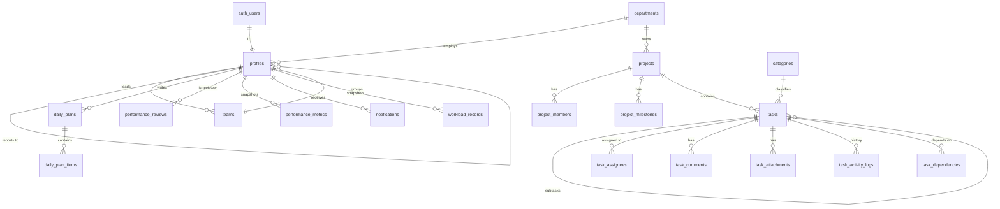

# Architecture

## 1. Overview

```
Browser ──► Next.js 16 (App Router, React Server Components)
              │  proxy.ts – refreshes the Supabase session cookie, guards private routes
              │  Server Components – read data with the USER's JWT (RLS applies)
              │  Server Actions   – validate with Zod, call workflow RPCs / tables (RLS applies)
              │  Admin client     – service-role key, server only, used ONLY for Auth Admin API + demo seed
              ▼
          Supabase
              ├─ PostgreSQL: tables, views (security_invoker), RLS policies, SECURITY DEFINER workflow functions,
              │              triggers (history, audit, guards, scoring), pg_cron jobs
              ├─ Auth: e-mail/password, roles in profiles (+ app_metadata)
              ├─ Storage: private bucket task-attachments (per-task policies)
              └─ Realtime: notifications table → live bell
```

**Design principles**
- *The database is the source of truth for rules.* Permissions (RLS), workflow transitions, history, overdue derivation, performance and workload maths live in SQL, so they hold no matter which client calls the API.
- *Server-first UI.* Pages are Server Components that query through RLS; interactivity (dialogs, Kanban, charts, forms) is isolated in small client components. Filters, sorting and pagination are URL parameters → every view is linkable and bookmarkable.
- *Minimal dependencies.* Calendar, Gantt timeline, Kanban drag-and-drop, CSV export and multi-select are implemented without extra libraries.

## 2. Folder structure

```
supabase/
  migrations/                 7 ordered SQL migrations (schema → security → workflow → analytics → storage/cron → reference/demo → hardening)
  setup.sql                   all migrations concatenated (paste into the SQL editor)
scripts/                      create-admin.mjs, seed-demo.mjs (service role, run locally)
src/
  proxy.ts                    Next.js 16 proxy (session refresh + route guard)
  app/
    login, forgot-password, reset-password, auth/confirm
    (app)/                    authenticated shell (sidebar + top bar)
      dashboard  tasks (/, my, new, [id])  planner (/, team)  employees (/, [id])
      projects (/, [id])  performance (/, [employeeId], review)  workload  reports (/, [slug])
      notifications  settings (/, audit)  search  profile
    api/reports/[slug]        CSV export (RLS-scoped)
    api/cron/daily            optional daily job (CRON_SECRET)
  components/
    ui/                       shadcn/ui primitives (Radix + Tailwind)
    layout/ shared/ charts/   shell, badges, tables, filters, KPI cards, Recharts wrappers
    tasks/ planner/ projects/ performance/ employees/ settings/ notifications/ workload/ profile/
  lib/
    supabase/                 server, browser, admin (server-only), proxy clients
    actions/                  server actions per module ("use server")
    queries/                  server data helpers
    domain/                   pure logic: scoring, workload, dates, periods, csv, permissions, planner (unit-tested)
    validation/schemas.ts     Zod schemas shared by forms and actions
    reports.ts                the 10 report definitions (page + CSV use the same code)
tests/
  unit/                       Node test-runner tests for lib/domain + validation
  db/                         PostgreSQL test-suite (RLS, workflow, analytics, demo) + Supabase emulation stub
docs/
```

## 3. Database schema



| Table | Purpose |
|---|---|
| `profiles` | Employee master (ID, name, e-mail, designation, department, team, manager, role, employment status, active flag, joining date, capacity) |
| `departments`, `teams`, `categories` | Organisation and HR work categories (configurable) |
| `projects`, `project_members`, `project_milestones` | Projects / initiatives |
| `tasks` | Core task record incl. priority, complexity, estimates, status, %, submission/approval, quality rating, delay cause, recurrence |
| `task_assignees` | Many-to-many assignments |
| `task_comments`, `task_attachments`, `task_dependencies` | Collaboration, evidence, sequencing |
| `task_activity_logs` | Append-only field-level history (who, what, old → new, reason) |
| `daily_plans`, `daily_plan_items` | Daily planner |
| `performance_reviews` | Reviews with frozen weights, recomputed automatic metrics, manager ratings, score, category, warnings |
| `performance_metrics` | Monthly metric snapshots (pg_cron) |
| `notifications`, `notification_preferences` | In-app notifications |
| `workload_records` | Daily utilisation snapshots |
| `system_settings` | Key/JSON configuration (validated by trigger) |
| `audit_logs` | Append-only audit trail for master data, settings and reviews |

**Views** (`security_invoker`): `task_overview` (derived overdue status, days overdue, assignee names, on-time flag), `project_overview` (effort-weighted progress, delays), `employee_directory` (live counters, latest score).

**Key functions**: `create_task`, `update_task_progress`, `submit_task`, `review_task`, `reopen_task`, `change_task_deadline`, `set_delay_cause`, `cancel_task`, `reassign_task`, `escalate_task`, `run_deadline_checks`, `calc_employee_performance`, `team_performance`, `performance_trend`, `workload_overview`, `dashboard_summary`, `department_performance`, `refresh_performance_metrics`, `record_workload_snapshot`, `seed_demo_data`, `clear_demo_data`.

Integrity: UUID keys, foreign keys with explicit `on delete` behaviour, check constraints (dates, ranges, completion consistency, no self-management/self-review), unique constraints, 30+ indexes, `updated_at` triggers.

## 4. Permission matrix (enforced by RLS + workflow functions)

| Capability | Admin | Team Lead | Employee |
|---|---|---|---|
| View tasks | All | Own team's + assigned by them | Assigned to them |
| Create / assign tasks | Anyone | Own team only | – |
| Update progress / block | ✓ | Team tasks | Own tasks |
| Submit for review | – | Own tasks | Own tasks |
| Approve / request changes / reopen / extend / cancel / reassign | ✓ | Team tasks | – |
| Edit task descriptive fields | ✓ | Team tasks | – |
| Change status/deadline/% directly (bypassing workflow) | ✗ (blocked by trigger) | ✗ | ✗ |
| Delete history / audit entries | ✗ | ✗ | ✗ |
| Employee master data, roles, deactivate | ✓ | – | – (phone only via RPC) |
| Daily plans | Read all | Read team | Own (read/write) |
| Performance reviews | All | Team (not self) | Own, finalized only, read-only |
| Workload, reports | All | Team | Own workload via dashboard |
| Settings, categories, departments, audit log | ✓ | Read | Read reference data |
| Files | Tasks visible to them | Tasks visible | Own tasks; delete own uploads |

## 5. Formulas

**Effort weight** of a task = `estimated_hours (default 4) × complexity multiplier (1 / 1.5 / 2)`.

**Eligible tasks** (per employee, period) = leaf tasks assigned to them, not cancelled, whose (approved) due date falls in the period and whose outcome is known (completed, or open and past due). Excluded: not yet due, awaiting review, delays classified *external/management*.

- **Completion rate** = Σ weight(completed) ÷ Σ weight(eligible) × 100
- **On-time delivery** = on-time completions ÷ (completed + missed, excluding excused lates) × 100; delivery date = last submission time
- **Quality** = average manager task rating ÷ scale × 100 (or the reviewer's quality override)
- **Ownership / Communication** = manager rating ÷ scale × 100
- **Overall** = Σ (KPI score × weight) ÷ Σ weights of available KPIs (re-normalised; a warning states the coverage)
- **Category** from bands (90/80/70/60); `Insufficient data` when eligible tasks < minimum (default 3)

**Workload utilisation** = Σ over open leaf tasks starting within the horizon of `estimate × (1 − %/100) ÷ number of assignees` ÷ (`working days in horizon × hours/day` or the person's weekly capacity ÷ working days per week). Bands: <60 underutilized, ≤90 balanced, ≤110 high, >110 overloaded (configurable).

**Project progress** = Σ(estimate × %) ÷ Σ estimate over non-cancelled leaf tasks.

## 6. Security notes
- Service-role key only in `lib/supabase/admin.ts` (imports `server-only`), used after an explicit admin check.
- Roles come only from `profiles.role` (set by admins) / `app_metadata` – never from user-editable metadata.
- `SECURITY DEFINER` functions use `set search_path = ''` and fully qualified names.
- Function `EXECUTE` revoked from `PUBLIC`/`anon`; internal helpers revoked from `authenticated`.
- CSV export escapes formula-leading values (CSV injection) and runs under the user's RLS scope.
- Security headers (frame-deny, nosniff, referrer policy, permissions policy) in `next.config.ts`.
- Session: HTTP-only cookies refreshed by the proxy; JWT validated with `getUser()`; “sign out of all devices”.
